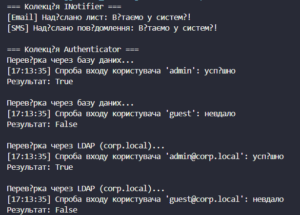

# Лабораторна робота №10
## Тема: Абстрактні класи та інтерфейси. Контракти та реалізації.
## Варіант: 7. INotifier та Authenticator

* INotifier (інтерфейс): метод void SendNotification(string message).

* EmailNotifier, SmsNotifier (реалізації INotifier).

* Authenticator (абстрактний клас): abstract bool Authenticate(string username, string password), конкретний метод void LogAttempt(string username, bool success).

* DatabaseAuthenticator, LdapAuthenticator (похідні від Authenticator).

# __Хід роботи:__
Було використано середовище розробки VS Code з розширеннями C# Dev Kit та .NET Install Tool. Було створено консольний проєкт lab10v7 у директорії OOP-Khomiak за допомогою команди dotnet new console -o OOP-Khomiak/lab10v7.

Відповідно до варіанту створив інтерфейс INotifier з методом SendNotification(string message) та два класи, що його реалізують: EmailNotifier і SmsNotifier. Кожен з них виводить повідомлення по-своєму, хоча між собою вони не пов'язані спадкуванням.

Далі створив абстрактний клас Authenticator з абстрактним методом Authenticate(string username, string password) та конкретним методом LogAttempt(string username, bool success), який виводить час, ім'я користувача та результат спроби входу. Похідні класи DatabaseAuthenticator і LdapAuthenticator перевизначають Authenticate() за допомогою override: перший перевіряє логін і пароль у словнику користувачів, другий імітує перевірку в домені corp.local. Обидва використовують успадкований метод LogAttempt(), не дублюючи код.

У методі Main() створив колекції List<INotifier> та List<Authenticator>, додав до них екземпляри відповідних класів і в циклі foreach викликав їхні методи. Результати в консолі показали поліморфну поведінку (різні реалізації одного методу) та використання спільної логіки базового класу (LogAttempt).

