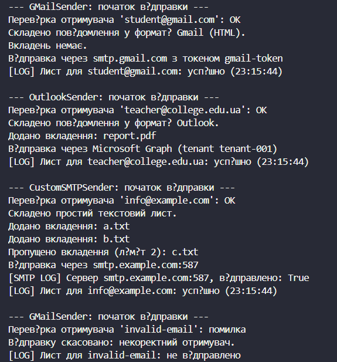

# Лабораторна робота №11
## Тема: DocumentProcessor: шаблонні кроки й реалізації.
## Варіант: 7. EmailSender (Відправка email)

* Шаблонний метод: Send() → ValidateRecipient, ComposeMessage, AttachFiles, SendViaServer, LogResult.

* Похідні класи: GMailSender, OutlookSender, CustomSMTPSender.

# __Хід роботи:__
Було використано середовище розробки VS Code з розширеннями C# Dev Kit та .NET Install Tool. Було створено консольний проєкт lab11v7 у директорії OOP-Khomiak за допомогою команди dotnet new console -o OOP-Khomiak/lab11v7.

Відповідно до варіанту створив абстрактний клас EmailSender із шаблонним методом Send(), який задає скелет алгоритму відправки листа та послідовно викликає п'ять кроків: ValidateRecipient(), ComposeMessage(), AttachFiles(), SendViaServer() і LogResult(). Метод Send() не є віртуальним, тому похідні класи не можуть змінити порядок кроків. Для зберігання стану обробки додав властивості Recipient, Subject, Body, Attachments, IsValid, IsSent та SentAt.

Кроки ComposeMessage() і SendViaServer() оголосив абстрактними (abstract), тому кожен похідний клас зобов'язаний їх реалізувати. Кроки ValidateRecipient(), AttachFiles() і LogResult() оголосив віртуальними (virtual) з базовою реалізацією: перший перевіряє наявність символу @ в адресі отримувача, другий виводить список вкладень, третій виводить у консоль результат відправки. Якщо перевірка отримувача не пройшла, Send() припиняє виконання і викликає лише LogResult().

Далі створив три похідні класи від EmailSender. GMailSender має унікальну властивість ApiToken та реалізує абстрактні методи для імітації відправки через smtp.gmail.com. OutlookSender має властивість TenantId, а також перевизначає ValidateRecipient(): спочатку викликає базову перевірку через base.ValidateRecipient(), після чого додатково блокує домен @spam.com. CustomSMTPSender має властивості Host і Port, перевизначає AttachFiles(), обмежуючи кількість вкладень до двох, та LogResult(), додаючи до виводу інформацію про сервер і викликаючи базову реалізацію.

У методі Main() створив список List<EmailSender>, додав до нього об'єкти всіх трьох похідних класів та ще один GMailSender з некоректною адресою отримувача, після чого в циклі foreach викликав метод Send() для кожного об'єкта. Результати в консолі показали, що спільна послідовність кроків виконується однаково для всіх класів, а конкретна поведінка кроків відрізняється залежно від реалізації. Для некоректної адреси відправку було скасовано ще на етапі перевірки, а для CustomSMTPSender третє вкладення було пропущено через ліміт.

