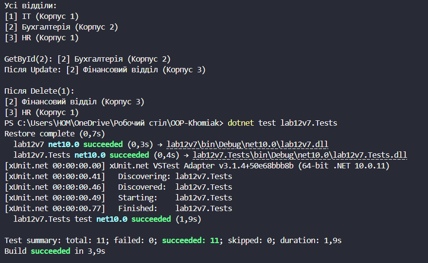

# Лабораторна робота №12
## Тема: Узагальнені типи (Generics). IRepository з where-обмеженнями та тестами.
## Варіант: 7. Department (Відділ)

* Сутність: Department з властивостями Name (string) та Location (string).

* Типи: IEntity, IRepository\<T\> (where T : class, IEntity), InMemoryRepository\<T\>.

* Посилання на GitHub-репозиторій:
  * Основний проєкт lab12v7: https://github.com/khomiakavkn25-netizen/OOP-Khomiak/tree/main/lab12v7
  * Тестовий проєкт lab12v7.Tests: https://github.com/khomiakavkn25-netizen/OOP-Khomiak/tree/main/lab12v7.Tests

# __Хід роботи:__
Було використано середовище розробки VS Code з розширеннями C# Dev Kit та .NET Install Tool. Було створено консольний проєкт lab12v7 у директорії OOP-Khomiak за допомогою команди dotnet new console -o lab12v7. Окремо було створено тестовий проєкт lab12v7.Tests на основі шаблону xUnit командою dotnet new xunit -o lab12v7.Tests, після чого додав до нього посилання на основний проєкт командою dotnet add reference ../lab12v7/lab12v7.csproj.

Відповідно до варіанту створив інтерфейс IEntity з єдиною властивістю int Id { get; set; }, який описує будь-яку сутність, що має ідентифікатор. На його основі створив клас Department, який реалізує IEntity і має властивості Name та Location. Для зручного виводу в консоль перевизначив у ньому метод ToString(), який повертає рядок у форматі "[Id] Name (Location)".

Далі створив узагальнений інтерфейс IRepository\<T\> із п'ятьма методами: GetById(int id), GetAll(), Add(T item), Update(T item) та Delete(int id). На тип-параметр T наклав обмеження where T : class, IEntity. Обмеження IEntity гарантує, що в репозиторії можна звертатися до властивості Id, а обмеження class дозволяє методу GetById повертати null (тип T?), якщо елемент з таким Id не знайдено.

Інтерфейс реалізував у класі InMemoryRepository\<T\>, який зберігає елементи у приватному списку List\<T\>. Метод Add() автоматично присвоює новий Id, якщо в доданого елемента Id дорівнює 0, а при спробі додати елемент з уже існуючим Id генерує ArgumentException. Методи Update() і Delete() для неіснуючого елемента генерують KeyNotFoundException. Метод GetAll() повертає копію списку, тому зовнішній код не може змінити внутрішній стан репозиторію. Усі методи перевіряють вхідні дані, а Add() і Update() відхиляють null через ArgumentNullException.

У проєкті lab12v7.Tests створив клас InMemoryRepositoryTests з 11 юніт-тестами (атрибут [Fact]). Для методу Add перевірив додавання нового елемента з присвоєнням Id, відхилення дубліката Id та відхилення null. Для GetById перевірив отримання існуючого елемента і повернення null для неіснуючого Id. Для GetAll перевірив повернення всіх елементів та порожнього результату. Для Update перевірив оновлення існуючого елемента і виняток для неіснуючого. Для Delete перевірив видалення існуючого елемента і виняток для неіснуючого. Перевірки виконав методами Assert.Equal, Assert.NotNull, Assert.Null, Assert.Single, Assert.Empty та Assert.Throws.

У методі Main() створив екземпляр InMemoryRepository\<Department\> через інтерфейс IRepository\<Department\>, додав три відділи (IT, Бухгалтерія, HR), вивів їх у консоль, отримав другий відділ за Id, оновив його на "Фінансовий відділ" та видалив перший відділ. Для коректного виведення українських літер у консолі встановив Console.OutputEncoding = System.Text.Encoding.UTF8. Результати в консолі показали, що всі CRUD-операції працюють коректно, а команда dotnet test завершилась успішно: усі 11 тестів пройдено.

