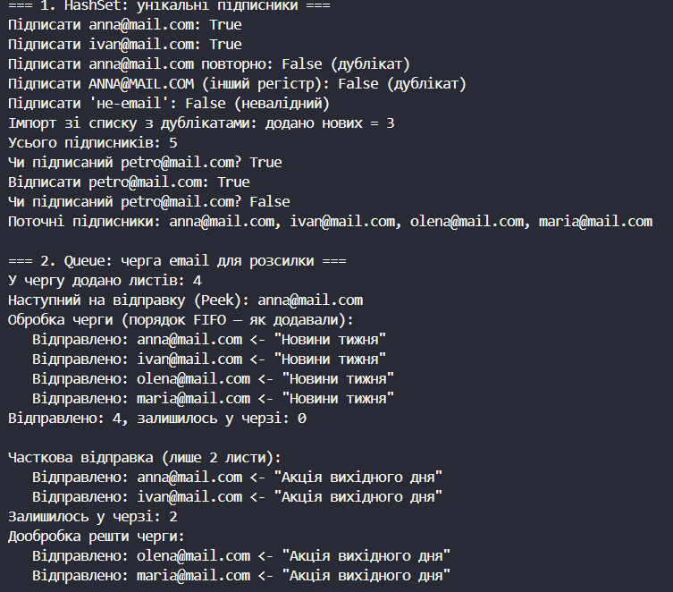
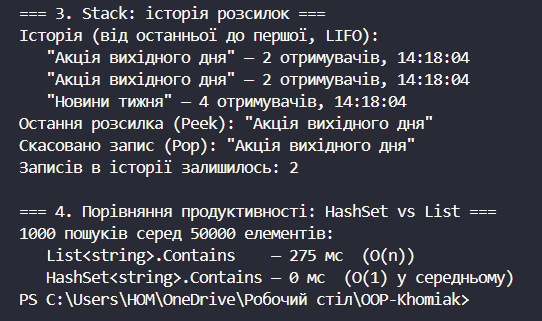

# Лабораторна робота №14
## Тема: HashSet/Queue/Stack: практичні сценарії.
## Варіант: 7. Система підписок

* Сутність: SubscriptionSystem з колекціями підписників, черги розсилки та історії розсилок.

* Типи: MailMessage, MailingRecord, SubscriptionSystem.

* Колекції: HashSet\<string\> (унікальні підписники), Queue\<MailMessage\> (черга email для розсилки), Stack\<MailingRecord\> (історія розсилок).

* Посилання на GitHub-репозиторій:
  * Проєкт lab14v7: https://github.com/khomiakavkn25-netizen/OOP-Khomiak/tree/main/lab14v7

# __Хід роботи:__
Було використано середовище розробки VS Code з розширеннями C# Dev Kit та .NET Install Tool. Було створено консольний проєкт lab14v7 у директорії OOP-Khomiak за допомогою команди dotnet new console -o OOP-Khomiak/lab14v7. Назва проєкту відповідає номеру мого варіанта — 7.

Відповідно до варіанту створив два допоміжні записи (record) для представлення даних. Запис MailMessage містить адресу отримувача To та тему листа Subject і описує один лист у черзі на відправлення. Запис MailingRecord містить тему розсилки Subject, кількість отримувачів Recipients та час відправки SentAt і описує одну виконану розсилку в історії.

Далі створив клас SubscriptionSystem, який містить три приватні колекції: HashSet\<string\> для підписників, Queue\<MailMessage\> для черги розсилки та Stack\<MailingRecord\> для історії розсилок. Для множини підписників у конструкторі HashSet передав StringComparer.OrdinalIgnoreCase, тому адреси anna@mail.com та ANNA@MAIL.COM вважаються однаковими. Також додав публічні властивості SubscribersCount, QueueCount та HistoryCount, які повертають кількість елементів у відповідних колекціях.

Для першої підзадачі з HashSet реалізував методи Subscribe(), Unsubscribe(), IsSubscribed() та ImportSubscribers(). Метод Subscribe() відхиляє порожні рядки та адреси без символу @, а для коректних адрес викликає Add(), який повертає false, якщо такий підписник уже існує. Завдяки цьому унікальність підписників забезпечується автоматично. Метод ImportSubscribers() додає адреси зі списку, що може містити дублікати, і повертає кількість фактично доданих нових підписників. Методи Unsubscribe() та IsSubscribed() використовують Remove() і Contains().

Для другої підзадачі з Queue реалізував методи EnqueueMailing(), PeekNext() та ProcessQueue(). Метод EnqueueMailing() додає в чергу лист із заданою темою для кожного підписника за допомогою Enqueue(). Метод PeekNext() повертає перший елемент черги без видалення. Метод ProcessQueue() вилучає листи з початку черги методом Dequeue() і виводить повідомлення про відправку в порядку надходження, тобто за принципом FIFO. Метод має необов'язковий параметр limit, який дозволяє обробити лише частину черги. Після відправки метод записує розсилку в історію.

Для третьої підзадачі зі Stack реалізував методи PeekLastMailing(), UndoLastMailing() та GetHistory(). Запис про розсилку додається на вершину стека методом Push() наприкінці ProcessQueue(). Метод PeekLastMailing() повертає останню розсилку без видалення, UndoLastMailing() видаляє її методом Pop(), а GetHistory() повертає записи від найновішого до найстарішого, що відповідає принципу LIFO.

У методі Main() створив екземпляр SubscriptionSystem і по черзі продемонстрував роботу кожної колекції з виведенням опису кожного кроку в консоль. Для HashSet виконав підписку кількох адрес, спробу повторної підписки, підписку з іншим регістром, підписку з невалідною адресою, імпорт списку з дублікатами, перевірку наявності та відписку. Для Queue поставив розсилку «Новини тижня» в чергу, переглянув перший елемент, обробив чергу повністю, а потім поставив розсилку «Акція вихідного дня» і обробив її частково (2 листи) та дообробив решту. Для Stack вивів історію розсилок, переглянув останню розсилку та видалив її з вершини стека. Для коректного виведення українських літер у консолі встановив Console.OutputEncoding = Encoding.UTF8.

Наприкінці Main() виконав порівняння продуктивності HashSet та List. Заповнив List\<string\> і HashSet\<string\> по 50 000 адрес, після чого виконав 1000 пошуків останнього елемента в кожній колекції та виміряв час за допомогою класу Stopwatch. Пошук у списку виконується за O(n), а в HashSet — за O(1) у середньому, тому HashSet показав значно кращий результат. Результати в консолі показали, що всі операції працюють коректно: дублікати не додаються, листи відправляються в порядку додавання, а історія розсилок виводиться у зворотному порядку.

