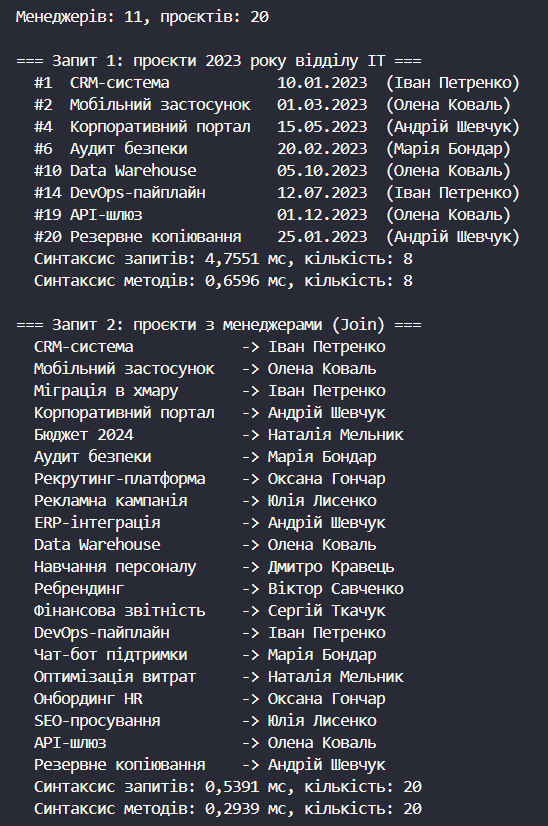
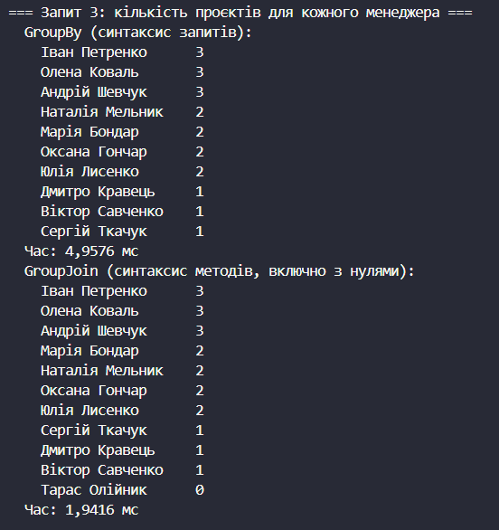
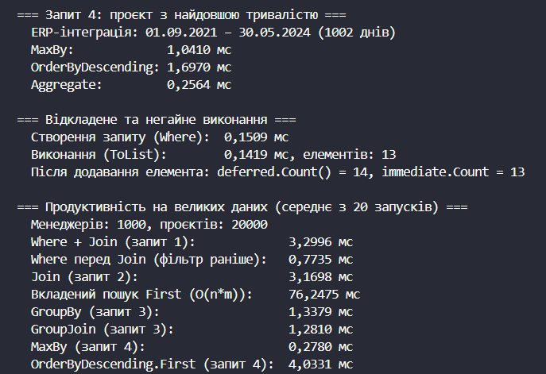

# Лабораторна робота №15
## Тема: LINQ в дії: фільтри, join, агрегації. Продуктивність.
## Варіант: 7. Управління проєктами

* Сутності: Project (Id, Name, StartDate, EndDate, ManagerId), Manager (Id, Name, Department).

* Запити: проєкти 2023 року відділу IT; об'єднання проєктів із менеджерами; кількість проєктів для кожного менеджера; проєкт з найдовшою тривалістю.

* Посилання на GitHub-репозиторій:
  * Проєкт lab15v7: https://github.com/khomiakavkn25-netizen/OOP-Khomiak/tree/main/lab15v7

# __Хід роботи:__
Було використано середовище розробки VS Code з розширеннями C# Dev Kit та .NET Install Tool. Було створено консольний проєкт lab15v7 у директорії OOP-Khomiak за допомогою команди `dotnet new console -o OOP-Khomiak/lab15v7`. Назва проєкту відповідає номеру мого варіанта — 7.

Відповідно до варіанту створив два записи (`record`) для представлення даних. Запис `Manager` містить ідентифікатор `Id`, ім'я `Name` та відділ `Department`. Запис `Project` містить ідентифікатор `Id`, назву `Name`, дати початку `StartDate` та завершення `EndDate` і ідентифікатор менеджера `ManagerId`, який пов'язує проєкт з менеджером. Колекції заповнив тестовими даними: `List<Manager>` з 11 менеджерів у відділах IT, Finance, HR та Marketing і `List<Project>` з 20 проєктів. Одного менеджера навмисно залишив без проєктів, щоб показати різницю між `GroupBy` та `GroupJoin`.

Для вимірювання часу створив допоміжні методи `Measure()` та `MeasureOne()`, які запускають запит через клас `Stopwatch` і повертають результат разом із часом у мілісекундах. Через відкладене виконання LINQ запит виконується лише під час ітерації, тому в `Measure()` результат матеріалізується викликом `ToList()`. Інакше було б виміряно лише створення запиту, а не його виконання.

Для першого запиту (проєкти, що починаються у 2023 році та належать відділу IT) виконав з'єднання проєктів із менеджерами за `ManagerId`, після чого відфільтрував за умовою `p.StartDate.Year == 2023 && m.Department == "IT"`. Запит реалізував у двох варіантах: у синтаксисі запитів (`from ... join ... where ... select`) та в синтаксисі методів (`Join()`, `Where()`, `Select()`). Обидва варіанти повернули однаковий набір проєктів.

Для другого запиту виконав об'єднання проєктів із їхніми менеджерами методом `Join()` і вивів назву проєкту та ім'я менеджера. Запит також реалізував у двох синтаксисах. Метод `Join()` будує хеш-таблицю за ключем з однієї колекції, тому з'єднання виконується за O(n + m).

Для третього запиту (кількість проєктів для кожного менеджера) використав два підходи. У синтаксисі запитів застосував `group by` з наступним `join`, а результат відсортував за спаданням кількості. У синтаксисі методів застосував `GroupJoin()` з викликом `Count()` для кожної групи. Різниця між підходами полягає в тому, що `GroupBy` повертає лише менеджерів, які мають проєкти, а `GroupJoin` повертає всіх менеджерів, зокрема й тих, у кого проєктів немає (кількість 0).

Для четвертого запиту (проєкт з найдовшою тривалістю) реалізував три способи: метод `MaxBy()` за різницею `EndDate - StartDate`, сортування `OrderByDescending().First()` у синтаксисі запитів та агрегацію методом `Aggregate()`, який послідовно порівнює тривалість поточного проєкту із найкращим знайденим. Усі три способи повернули один і той самий проєкт, а в консолі вивів його назву, дати та тривалість у днях.

Окремо продемонстрував відкладене та негайне виконання. Створив запит `projects.Where(p => p.StartDate.Year == 2023)` і виміряв час його створення, а потім час виконання при виклику `ToList()`. Після цього додав у колекцію новий проєкт 2023 року. Результат відкладеного запиту при повторній ітерації врахував новий елемент, а вже створений через `ToList()` список залишився без змін. Це підтверджує, що відкладений запит виконується заново при кожній ітерації, а негайне виконання фіксує результат на момент виклику.

Наприкінці `Main()` проаналізував продуктивність на великому наборі даних: згенерував 1000 менеджерів і 20 000 проєктів із фіксованим початковим значенням генератора випадкових чисел `Random(42)`. Кожен запит виконав 20 разів після прогріву JIT-компілятора та обчислив середній час. Порівняв кілька варіантів. Перший — `Where` разом із `Join` та `Where`, що виконується до `Join` (фільтрація раніше зменшує кількість елементів, які беруть участь в об'єднанні). Другий — `Join` та вкладений пошук `First()` для кожного проєкту, який має складність O(n·m) і через це працює повільніше (цей варіант виконав 3 рази, а не 20). Третій — `GroupBy` та `GroupJoin` для підрахунку проєктів. Четвертий — `MaxBy()` та `OrderByDescending().First()` для пошуку найдовшого проєкту.

На малому наборі з 20 проєктів різниця в часі майже непомітна, а перший запуск може бути повільнішим через JIT-компіляцію, тому для порівняння використовував великий набір даних. Результати показали, що синтаксис запитів і синтаксис методів працюють однаково швидко, бо компілятор перетворює перший на виклики методів розширення. `Join()` значно ефективніший за вкладений пошук `First()` завдяки хеш-таблиці. Фільтрація перед об'єднанням пришвидшує запит. `MaxBy()` та `Aggregate()` проходять колекцію один раз за O(n), тому швидші за `OrderByDescending().First()`, який сортує всю колекцію за O(n log n). Отже, для ефективних LINQ-запитів варто фільтрувати дані якомога раніше, використовувати `Join()` замість пошуку в циклі та уникати зайвого сортування, коли потрібен лише один елемент.

