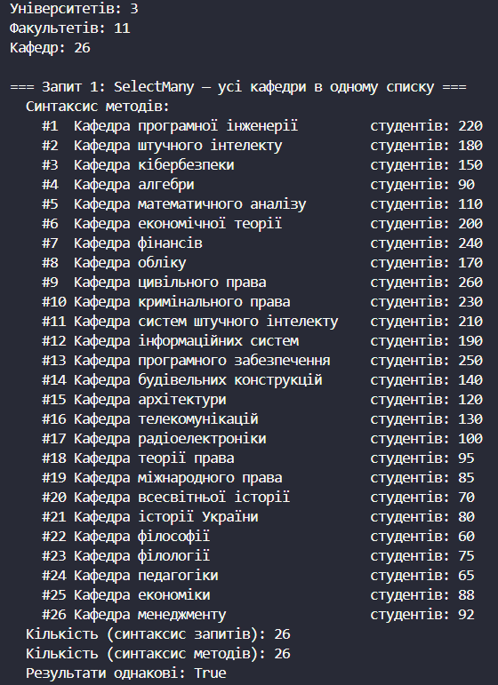
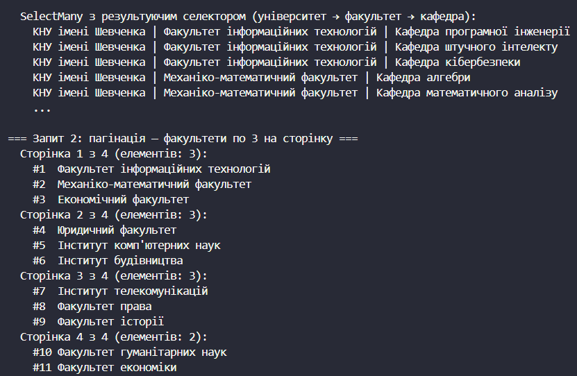
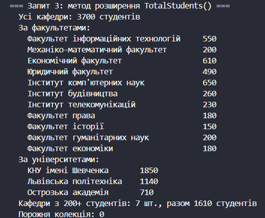

# Лабораторна робота №16
## Тема: LINQ: SelectMany, пагінація й custom extensions.
## Варіант: 7. Університети та їхні факультети з кафедрами

* Сутності: University (Id, Name, List\<Faculty\>), Faculty (Id, Name, List\<Department\>), Department (Id, Name, NumStudents).

* Запити: SelectMany для всіх кафедр усіх факультетів усіх університетів; пагінація факультетів по 3 на сторінку; метод розширення TotalStudents() для IEnumerable\<Department\>.

* Посилання на GitHub-репозиторій:
  * Проєкт lab16v7: https://github.com/khomiakavkn25-netizen/OOP-Khomiak/tree/main/lab16v7

# __Хід роботи:__
Було використано середовище розробки VS Code з розширеннями C# Dev Kit та .NET Install Tool. Було створено консольний проєкт lab16v7 у директорії OOP-Khomiak за допомогою команди `dotnet new console -o OOP-Khomiak/lab16v7`. Назва проєкту відповідає номеру мого варіанта — 7.

Відповідно до варіанту створив три записи (`record`) із вкладеними колекціями. Запис `Department` містить ідентифікатор `Id`, назву `Name` та кількість студентів `NumStudents`. Запис `Faculty` містить `Id`, `Name` та список кафедр `List<Department>`. Запис `University` містить `Id`, `Name` та список факультетів `List<Faculty>`. Для заповнення даних у `Main()` створив локальні функції `D()`, `F()` та `U()`, які автоматично нумерують об'єкти й дозволяють описати всю структуру одним вкладеним виразом. Тестові дані містять 3 університети, 11 факультетів і 26 кафедр.

Для першого запиту (усі кафедри всіх факультетів усіх університетів в одному списку) використав оператор `SelectMany`. У синтаксисі методів виконав два послідовні виклики: `universities.SelectMany(u => u.Faculties).SelectMany(f => f.Departments)`. У синтаксисі запитів той самий результат отримав через три послідовні `from` (`from u in universities from f in u.Faculties from d in f.Departments select d`), які компілятор перетворює саме на виклики `SelectMany`. За допомогою `SequenceEqual()` перевірив, що обидва варіанти повернули однакові послідовності. Додатково продемонстрував перевантаження `SelectMany` з результуючим селектором, яке дозволяє зберегти зв'язок між елементом верхнього рівня та вкладеним елементом: для кожної кафедри вивів назву університету, факультету та кафедри.

Для другого запиту реалізував пагінацію факультетів по 3 на сторінку. Спочатку розгорнув факультети всіх університетів в один список методом `SelectMany`, після чого обчислив кількість сторінок як `Math.Ceiling(faculties.Count / (double)pageSize)`. У циклі по номерах сторінок вибирав елементи поточної сторінки за формулою `Skip((page - 1) * pageSize).Take(pageSize)` і виводив їх у консоль із номером сторінки. Для 11 факультетів вийшло 4 сторінки: перші три містять по 3 факультети, а остання — 2. Остання неповна сторінка опрацьовується коректно, тому що `Take()` повертає лише ті елементи, що залишилися.

Для третього запиту створив статичний клас `DepartmentExtensions` з методом розширення `TotalStudents(this IEnumerable<Department> departments)`, який повертає суму `NumStudents` усіх кафедр у колекції через `Sum()`. На початку методу додав перевірку `ArgumentNullException.ThrowIfNull()`. Оскільки метод розширює `IEnumerable<Department>`, його можна викликати для будь-якої послідовності кафедр. Продемонстрував це для всіх кафедр одразу, для кафедр кожного факультету (`f.Departments.TotalStudents()`), для кожного університету (після `SelectMany` по факультетах), для відфільтрованої послідовності кафедр із 200 і більше студентами та для порожнього списку, де результат дорівнює 0.

Результати в консолі показали, що всі запити працюють коректно: `SelectMany` повертає всі 26 кафедр, пагінація розбиває факультети на 4 сторінки, а `TotalStudents()` однаково працює для колекцій різного походження. Отже, `SelectMany` зручно застосовувати для роботи з вкладеними колекціями, `Skip()` та `Take()` — для пагінації, а власні методи розширення дозволяють винести бізнес-логіку в окремий багаторазовий метод і викликати його в ланцюжку LINQ-операцій.

  