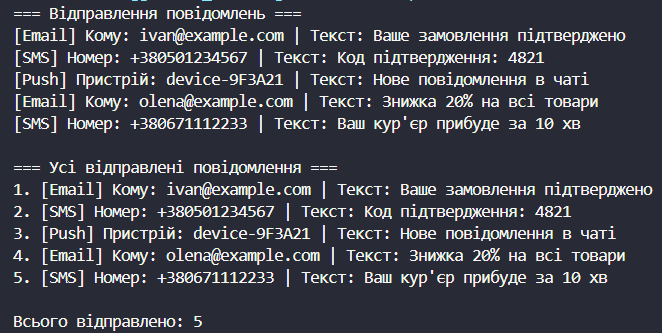

# Лабораторна робота №8
## Тема: Поліморфізм: динамічне зв'язування та перевизначення методів.
## Варіант: 7. Поліморфні повідомлення: Notification → EmailNotification, SMSNotification, PushNotification
* Notification (базовий): властивість Message, конструктор, virtual void Send().

* EmailNotification (похідний): властивість RecipientEmail, конструктор base, override void Send().

* SMSNotification (похідний): властивість PhoneNumber, конструктор base, override void Send().

* PushNotification (похідний): властивість DeviceId, конструктор base, override void Send().

* Агрегація: вивести всі відправлені повідомлення.

# __Хід роботи:__
Було використано середовище розробки VS Code з розширеннями C# Dev Kit та .NET Install Tool. Було створено консольний проєкт lab8v7 у директорії OOP-Khomiak за допомогою команди dotnet new console -o OOP-Khomiak/lab8v7.

Відповідно до варіанту створив ієрархію класів Notification, EmailNotification, SMSNotification та PushNotification. Клас Notification (базовий) містить властивість Message, конструктор для її ініціалізації та віртуальний метод Send(). Також у базовий клас було додано властивість SentLog із захищеним сеттером, у яку кожна реалізація методу Send() записує текст відправленого повідомлення. Це потрібно для агрегації результатів, оскільки метод Send() не повертає значення (void).

Клас EmailNotification (похідний) успадковує Notification, додає властивість RecipientEmail, викликає конструктор базового класу за допомогою base() та перевизначає метод Send() за допомогою ключового слова override. Клас SMSNotification (похідний) додає властивість PhoneNumber, а клас PushNotification додає властивість DeviceId. Обидва викликають конструктор базового класу через base() та перевизначають метод Send() за допомогою override, кожен зі своєю унікальною реалізацією та форматом виводу.

У класі Program в методі Main() було створено колекцію List<Notification>, до якої додано по кілька екземплярів усіх трьох похідних класів. Далі в циклі foreach для кожного елемента колекції було викликано віртуальний метод Send(). Для кожного об'єкта автоматично викликалася реалізація, що відповідає його фактичному типу (динамічне зв'язування), хоча змінна циклу має тип базового класу Notification.

Для агрегації результатів було пройдено по колекції вдруге та зібрано значення SentLog кожного об'єкта в список sentMessages. Цей список виведено в консоль нумерованим переліком разом із загальною кількістю відправлених повідомлень. Результати виконання в консолі наочно довели, що завдяки поєднанню virtual та override один і той самий виклик Send() через посилання базового типу поводиться по-різному залежно від фактичного типу об'єкта.

