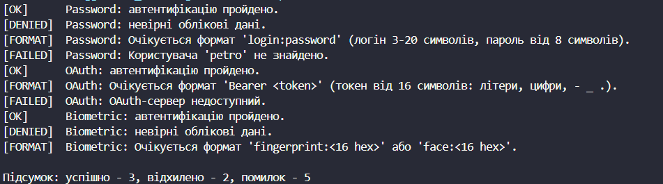

# Лабораторна робота №9
## Тема: Поліморфні сервіси: обробка помилок у поліморфних класах.
## Варіант: 7. Аутентифікація: AuthProvider → PasswordAuth, OAuthAuth, BiometricAuth
* AuthProvider (базовий абстрактний клас): властивість Name, конструктор, abstract bool Authenticate(string credentials).

* PasswordAuth (похідний): база користувачів Users, формат `login:password`, override bool Authenticate().

* OAuthAuth (похідний): властивості ClientId, ServerAvailable, ValidTokens, формат `Bearer <token>`, override bool Authenticate().

* BiometricAuth (похідний): властивості DeviceReady, EnrolledTemplates, формат `fingerprint:<16 hex>` / `face:<16 hex>`, override bool Authenticate().

* AuthService: метод AuthenticateAll(List<AuthRequest> requests) з обробкою винятків.

# __Хід роботи:__
Було використано середовище розробки VS Code з розширеннями C# Dev Kit та .NET Install Tool. Було створено консольний проєкт lab9v7 у директорії OOP-Khomiak за допомогою команди dotnet new console -o OOP-Khomiak/lab9v7.

Відповідно до варіанту створив абстрактний базовий клас AuthProvider із властивістю Name, конструктором та абстрактним методом Authenticate(string credentials), що повертає bool. Для обробки помилок створив власні винятки: InvalidCredentialsFormatException (невірний формат даних) та AuthenticationFailedException (технічні збої: користувача не знайдено, сервер недоступний, сканер не готовий). Невірні облікові дані повертають false, а проблеми з форматом чи сервісом призводять до винятку.

Похідні класи PasswordAuth, OAuthAuth та BiometricAuth викликають конструктор базового класу через base(), мають унікальні властивості та перевизначають метод Authenticate() за допомогою override. Кожен клас перевіряє формат credentials за допомогою регулярного виразу, а також виконує власну логіку перевірки (пароль, токен, біометричний шаблон).

Клас AuthService містить метод AuthenticateAll(List<AuthRequest> requests), який у циклі foreach поліморфно викликає Authenticate() для кожного запиту. Виклик обгорнуто в try-catch з окремими обробниками для кожного типу винятків, тому помилка в одному запиті не зупиняє обробку решти. Після завершення виводиться підсумок: кількість успішних, відхилених запитів і помилок.

У методі Main() було створено провайдерів із тестовими даними та список із 10 запитів: успішні входи, невірний пароль, неіснуючий користувач, некоректні формати, недоступний OAuth-сервер та нерозпізнаний біометричний шаблон. Результати в консолі показали, що виклик Authenticate() через посилання базового типу працює по-різному залежно від фактичного типу об'єкта (динамічне зв'язування).

